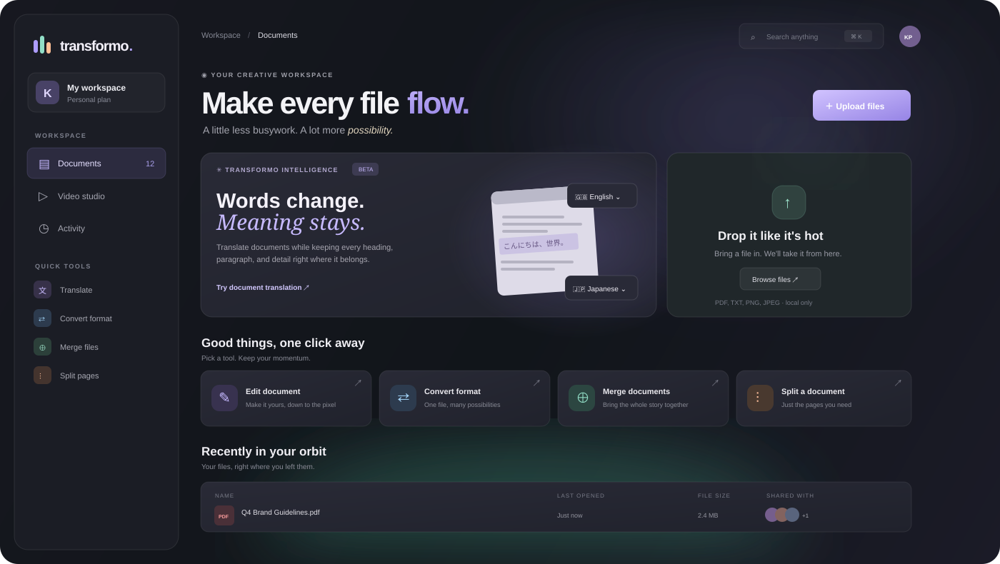

<div align="center">

# Transformo

### Shape every file. Keep every detail.

**A calm, layout-aware workspace for documents, languages, and video.**

[Explore the experience](#-the-experience) · [Get started](#-getting-started) · [Roadmap](#-where-transformo-can-go)

<br />



<br />


</div>

---

## ✦ The idea

Documents and videos are more than files. They are carefully arranged ideas. Transformo brings everyday file work into one considered space, with a special focus on the detail most tools overlook: **the position of the content**.

Translate a page and its text should stay in place. Edit a paragraph and the rest of the layout should remain composed. Move from a document to a video project without starting over in an entirely different-feeling tool.

Transformo is a local-first web workspace for common document operations and a first cut at the video studio.

## Design direction

Document tools open in a dedicated page workspace, with the file and its preview kept in view through the operation. Tool discovery follows the clear task groupings used by [iLovePDF](https://www.ilovepdf.com/), while the interface uses layered, translucent surfaces informed by [Apple's Human Interface Guidelines for materials](https://developer.apple.com/design/human-interface-guidelines/materials).

## ✨ The experience

| Workspace | What it is for |
| --- | --- |
| **Documents** | Keep uploaded files in a device-local workspace, then merge PDFs in a reorderable file queue, select page thumbnails or enter ranges to split, reorder/rotate/remove PDF pages, add watermarks or page numbers, compress PDFs with quality presets, convert PDFs to text, PNG, or JPG, preview DOCX pages before creating a visual PDF, extract Word paragraphs/lists/tables and PowerPoint slide text, export XLSX worksheets to CSV, combine images into PDF, or paginate text files as PDF. Tools open in a full-page workspace. |
| **Layout-aware editing and translation** | Work from full-page PDF or rendered Word previews. Edit PDF text fields or DOCX paragraphs directly over their original page positions, with paragraph text auto-fitted inside its original Word page box. OCR scanned PDFs in an expandable set of languages, translate related text blocks with the browser Translator API when available, compare original and transformed pages, and export a layout-aware PDF. The language choices use compact buttons rather than dropdowns; translated Arabic and Hebrew blocks are laid out right-to-left. |
| **Video studio** | Edit directly in the video page: add multiple local clips, set each clip’s in/out points, reorder or remove clips on a timeline, import and edit SRT captions, translate timed subtitle cues, preview them in place, burn them into a WebM export, and export the subtitle track separately. Save named edit projects locally to reopen clip order, trims, and subtitle cues later. |

### Small details, big difference

- **A workspace that feels like one place.** A translucent, layered interface, soft color, and restrained motion give the tools room to breathe.
- **A quick way in.** Drag files into the workspace, browse for them, or use focused action cards for conversion, merging, and page tasks. Conversion choices are cards that match the selected file type, and merge files can be reordered before combining.
- **Search that moves with you.** Find recent files and jump straight into a tool with `⌘ K` (or `Ctrl K`).
- **Responsive by design.** The desktop sidebar becomes a compact navigation rail, then a bottom bar on small screens.
- **Reduced-motion support.** Interface animation respects the operating system preference.

## 🚀 Getting started

Transformo is a static web app: no package manager or build step is required. The app loads PDF.js, pdf-lib, JSZip, docx-preview, html2canvas, and Tesseract.js from public CDNs. Start it from a local web server so browser file APIs, OCR workers, and the optional Translator API can run:

```bash
git clone https://github.com/KESHAVAPANDI/transformoDocs.git
cd transformoDocs
```

Then open `http://localhost:8000` in a recent Chrome or Edge browser. You can also use VS Code's Live Server extension.

```bash
python -m http.server 8000
```

Internet access is needed to load the conversion and PDF libraries. The selected documents and videos are processed in the browser tab and are not posted to a Transformo server.

PDF compression is an image-based option for visual fidelity: it redraws each page as a JPEG, so the exported file does not keep searchable text, links, or form fields. Some source PDFs may not shrink; in that case Transformo keeps the original and suggests trying the compact preset.

## 🧭 Where Transformo can go

The next step is to expand format coverage and make the layout-aware workflows more robust. A practical path could look like this:

1. **Expand Office editing.** Make DOCX edits reversible and preserve the source document structure, then add in-place PPTX and spreadsheet editing while retaining their native text, styles, and structures.
2. **Improve layout translation.** The current PDF workflow uses positioned text lines and marks up the same page coordinates. Add paragraph context, font matching, non-white background handling, and an overflow review before export.
3. **Make editing reversible.** Keep the source untouched, store edits as structured operations, and offer a clear before/after comparison with undo.
4. **Improve OCR for scans.** Add confidence scores, better rotation and column handling, and an in-app review step before edits or translation.
5. **Grow the video studio.** Add subtitle styling, transitions, and a wider range of export formats.
6. **Keep privacy visible.** Prefer local processing where practical, explain when a task needs a server, and make file retention clear.

For layout-preserving translation, **“preserve positions” should mean preserving each text block’s anchor and page geometry, then adapting font size or line breaks inside that block**. Some translations are longer than their source; the product should surface those collisions for a human to resolve.

## 🧱 Project structure

```text
transformoDocs/
├── index.html          # Workspace and editor views
├── styles.css          # Glass interface, responsive layout, and motion
├── operations.css      # Document/video editor styles
├── video.css           # Video editing controls
├── app.js              # App navigation and task workflows
├── document-engine.js  # In-browser PDF and image/text conversion
├── ocr.css             # OCR controls
├── workspace-store.js  # Device-local file shelf and video projects backed by IndexedDB
├── workspace.css       # Saved-file selection and workspace controls
├── feedback.css        # Toast feedback above dialogs
├── tool-workspace.css  # Full-page document tools and page previews
├── video-engine.js     # Local multi-clip projects, trim, captions, SRT, and WebM export
├── assets/preview.svg  # README workspace illustration
└── README.md           # Setup, features, limits, and roadmap
```

## 🛠 Current prototype boundaries

PDF merge, visual page selection, page organization, watermarks, page numbers, image/text conversion, PDF-to-text/PNG/JPG export, positioned block editing/translation, OCR for image-only PDF pages, and multi-clip video timeline export are implemented in the browser. OCR language data is downloaded on demand and recognition runs locally. There are deliberate limits:

- PDF editing and translation exports are image-backed to retain page appearance and Unicode text. DOCX editing, translation, and visual conversion also export image-backed PDFs; output text is not searchable or selectable.
- Page organizing previews up to 80 pages at a time. Pages beyond the preview remain in their original order after the visible pages.
- Page selection for splitting previews up to 80 pages. Enter a page range to extract later pages.
- Translation previews show up to 24 pages at a time; every page is included in the exported PDF. The in-page editor previews up to 80 pages.
- Replacement text uses a neutral dark font rather than preserving every source font and color. Translated blocks wrap within the original block area, shrink when needed, and are flagged if they still overflow.
- OCR can misread low-quality scans, handwriting, rotated text, and complex layouts. Review recognized text before translating or exporting.
- Translation uses the browser's built-in Translator API when that browser supports the selected language pair. Browser support and available language models vary; there is no cloud translation fallback.
- The translation picker follows Chrome's documented language-code list, while the chosen pair is still checked against the browser's actual model availability. The API is not available in every browser. See [Chrome's Translator API documentation](https://developer.chrome.com/docs/ai/translator-api/).
- Replacement covers sample their nearby page color, which works for many tinted regions. Gradients, photographs, columns, and rotated text still need careful review.
- Video export joins trimmed timeline clips into a WebM sequence with timed, burned-in subtitles and audio where the browser supports media capture. SRT import accepts numbered cues with standard hours:minutes:seconds,milliseconds timestamps; cue times are measured against the combined timeline, and cues outside its duration are omitted from export. Subtitle translation uses the browser's built-in Translator API and translates from English. Transitions and MP4 export are not implemented yet.
- DOCX editing and DOCX-to-PDF use a browser-rendered page preview; editing overlays editable paragraphs at their source page positions and exports each page as an image. This is a best-effort rendering rather than a pixel-perfect Word export, and the PDF text is not searchable or selectable. DOCX-to-text and PPTX-to-text extract content without preserving document/slide layout or styling. XLSX-to-CSV exports worksheet values, not cell formatting; formula cells use saved values. DOCX paragraph editing is supported, while native Word structure editing, PPTX editing, and spreadsheet editing are not implemented.
- Files and saved video projects are persisted in this browser profile with IndexedDB. They stay on the device, but browser storage can be cleared by the user or browser; large video files may exceed available quota. Video projects refer to source clips in the local workspace, and Transformo prevents removing a clip while a saved project still uses it. Save changes manually; unsaved edits trigger a leave/reload warning. Static PDF/OCR libraries and OCR language data are fetched from CDNs.

## 💡 More ideas worth exploring

- **Layout confidence map:** highlight translated text blocks that fit comfortably, need smaller type, or require a human decision.
- **Parallel language pages:** compare source and translated pages side by side, with linked selections.
- **Glossary and tone memory:** keep product names, recurring terms, and preferred voice consistent across a project.
- **Document-to-video bridge:** turn a translated brief or presentation into a captioned video draft.
- **Batch recipes:** save a repeatable chain such as “translate to Spanish → export PDF → compress”.
- **Accessible output checks:** catch reading-order, contrast, caption, and document-tagging issues before export.

## 🤝 Contributing

Ideas, accessibility feedback, and thoughtful improvements are welcome. Open an issue to discuss a larger change before sending a pull request.

## 📄 License

This project is released under the MIT License. See [LICENSE](LICENSE).

<div align="center">
<br />
<sub>Made for the way you think. Built to keep the details in place.</sub>
</div>
